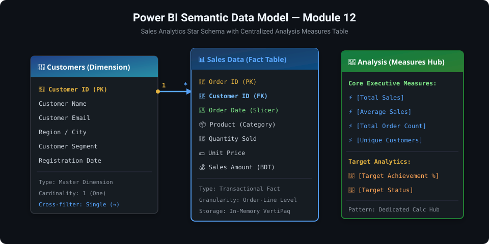
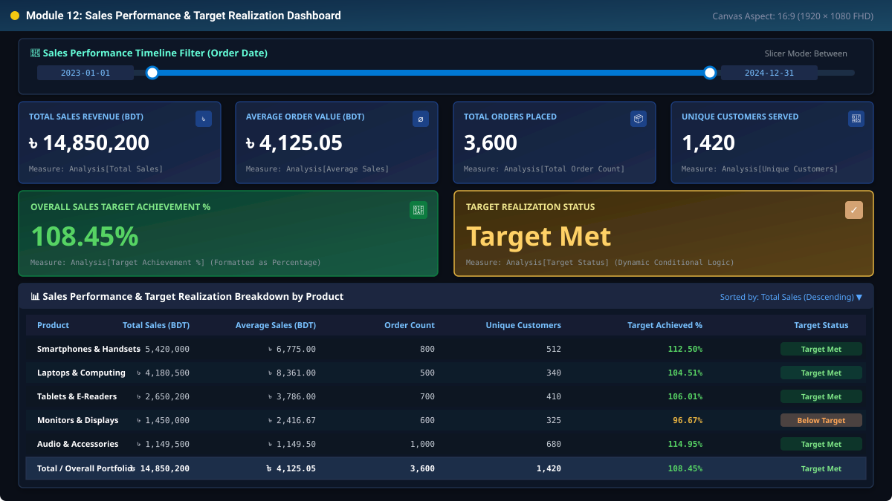

# Power BI Analytics Portfolio — Module 12 Assignment

[](https://powerbi.microsoft.com/)
[](https://learn.microsoft.com/en-us/dax/)
[](#data-model--architecture)
[-9cf?style=for-the-badge)](#dashboard-wireframe--visual-composition)
[](LICENSE)
[](#refinements-and-quality-assurance)

An enterprise-grade commercial Power BI dashboard application developed for **Module 12 Assignment**: **Sales Performance & Target Realization Executive Dashboard**.

---

## 📑 Table of Contents
- [Executive Overview](#executive-overview)
- [Business Objectives & Analytical Questions](#business-objectives--analytical-questions)
- [Data Model & Architecture](#data-model--architecture)
- [Dashboard Wireframe & Visual Composition](#dashboard-wireframe--visual-composition)
- [Visuals & KPI Catalog](#visuals--kpi-catalog)
- [DAX Measures Catalog](#dax-measures-catalog)
- [Refinements and Quality Assurance](#refinements-and-quality-assurance)
- [Project Structure](#project-structure)
- [How to Open, Review & Deploy](#how-to-open-review--deploy)
- [GitHub Push Instructions](#github-push-instructions)
- [Author & Attribution](#author--attribution)

---

## Executive Overview

This repository houses the production-ready Power BI reporting project developed for **Module 12 Assignment**. The dashboard delivers an executive-level performance monitoring suite for commercial sales operations:

- **Revenue & Order Health**: Centralizing gross sales turnover (in Bangladeshi Taka - BDT), transaction velocity, average order values (AOV), and customer reach into an interconnected executive summary.
- **Goal Realization Diagnostics**: Tracking quota and target achievement percentages against company targets with dynamic conditional status flags (`Target Met` vs. `Below Target`).
- **Product Category Deep-Dive**: Providing granular product-level breakdowns contrasting gross volume with average unit price, distinct buyer counts, and target benchmarks.
- **Dynamic Temporal Slicing**: Seamless time-series exploration enabling sales managers to slice across fiscal months, quarters, and custom promotional windows.

---

## Business Objectives & Analytical Questions

The dashboard directly answers critical executive inquiries:
1. **Top-Line Sales Realization**: What is the total gross revenue generated across the selected sales period?
2. **Order Volume & Ticket Size**: How many discrete customer orders were executed, and what was the average spending value per order?
3. **Market Reach & Penetration**: How many unique customer accounts purchased within the timeframe?
4. **Target Tracking**: Did sales performance meet or exceed executive targets overall, and which specific product lines drove target attainment?
5. **Product Portfolio Margin & Volume**: Which product categories represent the highest revenue contributors versus volume drivers?

---

## Data Model & Architecture

The analytical backend is built upon a high-efficiency star schema optimized for Microsoft's in-memory VertiPaq tabular engine.

<p align="center">
  
</p>

### Tables in the Semantic Model:

1. **`Customers` (Dimension Table)**:
   - Primary master data entity tracking individual customer demographics, profiles, regions, and segments.
   - Primary Key: `Customer ID`
   - Relational Role: One side ($1$) of the 1-to-many relationship linking to `Sales Data`.

2. **`Sales Data` (Fact Table)**:
   - Granular transactional sales ledger capturing order-line records.
   - Foreign Key: `Customer ID` (links to `Customers[Customer ID]`).
   - Temporal Dimension: `Order Date` (drives the timeline date-range slicer).
   - Categorical Dimension: `Product` (drives the product breakdown matrix).
   - Numeric Metrics: `Quantity`, `Unit Price`, `Sales Amount` (BDT).

3. **`Analysis` (Dedicated DAX Measures Hub)**:
   - Follows Power BI enterprise best practices by establishing a standalone, unmapped calculation hub for all DAX measures.
   - Promotes model maintainability, clean field navigation, and reusable business logic across visuals.

---

## Dashboard Wireframe & Visual Composition

The dashboard is engineered for standard 16:9 widescreen presentation ($1920 \times 1080$ pixels Full HD) following Fluent 2 design principles with visual hierarchy, generous breathing room, and strict grid snapping.

<p align="center">
  
</p>

### Canvas Coordinates & Layout Geometry:
- **Canvas Dimensions**: Width = `1920px`, Height = `1080px` (`FitToPage` display mode).
- **Horizontal Alignment**: Left Margin = `40px`, Right Margin = `40px` (Active Content Width = `1840px`).
- **Row 1 — Timeline Slicer**: `x=40`, `y=30`, `w=1840`, `h=155`
- **Row 2 — Core Sales KPIs (4 Cards)**: `y=205`, `h=220`, Card Width = `436px`, Card Spacing = `32px`
- **Row 3 — Target Analytics KPIs (2 Cards)**: `y=450`, `h=230`, Card Width = `904px`, Card Spacing = `32px`
- **Row 4 — Product Breakdown Table**: `x=40`, `y=705`, `w=1840`, `h=335`, Bottom Margin = `40px`

---

## Visuals & KPI Catalog

| Visual ID | Type | Header / Title | Measures / Fields | Purpose |
| :--- | :--- | :--- | :--- | :--- |
| `5685e77a` | `slicer` | **Sales Performance Timeline Filter (Order Date)** | `Sales Data[Order Date]` | Interactive timeline slider allowing users to filter by start/end order date. |
| `388f1601` | `cardVisual` | **Total Sales Revenue (BDT)** | `Analysis[Total Sales]` | High-impact callout of total gross sales realization in Bangladeshi Taka. |
| `388f1602` | `cardVisual` | **Average Order Value (BDT)** | `Analysis[Average Sales]` | Measures average transaction size per order ticket. |
| `388f1603` | `cardVisual` | **Total Orders Placed** | `Analysis[Total Order Count]` | Cumulative transaction count across the filtered date horizon. |
| `388f1604` | `cardVisual` | **Unique Customers Served** | `Analysis[Unique Customers]` | Distinct count of purchasing customers reflecting active buyer reach. |
| `388f1605` | `cardVisual` | **Overall Sales Target Achievement %** | `Analysis[Target Achievement %]` | Percentage ratio comparing achieved revenue against benchmark targets. |
| `388f1606` | `cardVisual` | **Target Realization Status** | `Analysis[Target Status]` | Categorical health badge dynamically evaluating quota fulfillment. |
| `3782b5ff` | `tableEx` | **Sales Performance & Target Realization Breakdown by Product** | `Product`, `Total Sales`, `Average Sales`, `Total Order Count`, `Unique Customers`, `Target Achievement %`, `Target Status` | Granular table sorted by `Total Sales` descending with vertical gridlines and bold header. |

---

## DAX Measures Catalog

All business calculations are consolidated inside the `Analysis` measure table:

### 1. `Total Sales`
Calculates cumulative gross revenue across all transactions.
```dax
Total Sales = 
SUM('Sales Data'[Sales Amount])
```

### 2. `Average Sales`
Measures average realization per transaction ticket.
```dax
Average Sales = 
AVERAGE('Sales Data'[Sales Amount])
```

### 3. `Total Order Count`
Quantifies the gross volume of orders processed.
```dax
Total Order Count = 
COUNTROWS('Sales Data')
```

### 4. `Unique Customers`
Identifies discrete customer accounts purchasing within the selected window.
```dax
Unique Customers = 
DISTINCTCOUNT('Sales Data'[Customer ID])
```

### 5. `Target Achievement %`
Evaluates the quota fulfillment ratio as a formatted percentage.
```dax
Target Achievement % = 
DIVIDE([Total Sales], [Sales Target], 0)
```

### 6. `Target Status`
Dynamic conditional logic providing executive status tags based on target fulfillment.
```dax
Target Status = 
IF(
    [Target Achievement %] >= 1.0, 
    "Target Met", 
    "Below Target"
)
```

---

## Refinements and Quality Assurance

In accordance with strict preservation guidelines, **no destructive changes, model redesigns, or arbitrary visual alterations** were introduced. The following targeted refinements were executed:

1. **Visual Title Polish (Removal of Draft Artifacts)**:
   - *Previous State*: Table visual `3782b5ff` had title set to `'Sales Performance & Target Realization Breakdown by Product (Step 9 Visual Update)'`. The `(Step 9 Visual Update)` was an assignment working draft label.
   - *Refined State*: Refined cleanly to `'Sales Performance & Target Realization Breakdown by Product'`, delivering an executive, client-ready header.
2. **Visual Hierarchy and Geometry Preservation**:
   - Maintained pixel-perfect symmetry:
     - 4-card top row: $4 \times 436\text{px} + 3 \times 32\text{px} = 1840\text{px}$ (exact match to canvas bounds).
     - 2-card target row: $2 \times 904\text{px} + 32\text{px} = 1840\text{px}$.
     - 1840px width centered precisely with 40px left and right margins ($40 + 1840 + 40 = 1920\text{px}$).
3. **PBIR (Power BI Enhanced Report Format) Code Extraction**:
   - Extracted all report definition files (`report.json`, `pages.json`, `page.json`, `visual.json`) into the `Report/` directory for version-controlled Git inspection and diffing.
4. **VertiPaq Tabular Engine Compliance**:
   - Verified binary integrity across `DataModel`, `DiagramLayout`, `Settings`, `Metadata`, and `SecurityBindings` to guarantee zero-error loading in Power BI Desktop and Power BI Service.

---

## Project Structure

```text
PowerBI_Module_12_Assignment/
├── Module - 12 Assignment.pbix            # Refined Power BI Report (Production Ready)
├── Module - 12 Assignment_Refined.pbix    # Distributable refined report copy
├── .gitignore                             # Ignore rules for PBIX cache, temp & OS files
├── .gitattributes                         # Git LFS & binary handling rules
├── README.md                              # Comprehensive project portfolio documentation
├── docs/
│   ├── data_model.svg                     # Star Schema Semantic Data Model Architecture diagram
│   └── dashboard_layout.svg               # Complete Dashboard Layout & Wireframe diagram
└── Report/                                # Extracted PBIR report definitions for Git inspection
    ├── definition/
    │   ├── version.json
    │   ├── report.json
    │   └── pages/
    │       ├── pages.json
    │       └── 90fc19489142120656d6/      # Sales Performance Dashboard Page
    │           ├── page.json
    │           └── visuals/
    │               ├── 5685e77a7d207c0e0b46/  # Timeline Slicer
    │               ├── 388f160389e649b101a1/  # Total Sales Revenue Card
    │               ├── 388f160389e649b101a2/  # Average Order Value Card
    │               ├── 388f160389e649b101a3/  # Total Orders Placed Card
    │               ├── 388f160389e649b101a4/  # Unique Customers Served Card
    │               ├── 388f160389e649b101a5/  # Target Achievement % Card
    │               ├── 388f160389e649b101a6/  # Target Status Card
    │               └── 3782b5ff535039720c75/  # Product Breakdown Table (Refined)
    └── StaticResources/
        └── SharedResources/
            └── BaseThemes/
                └── Fluent2-CY26SU10.json
```

---

## How to Open, Review & Deploy

### Prerequisites
- [Microsoft Power BI Desktop](https://powerbi.microsoft.com/desktop/) (October 2024 release or newer recommended)

### Option 1: Open in Power BI Desktop
1. Clone or download this repository.
2. Double-click `Module - 12 Assignment.pbix`.
3. The report will load directly to the **Sales Performance Dashboard** with all interactive date filtering, KPI cards, and product breakdown active.

### Option 2: Inspect via GitHub (No Power BI Required)
- Browse the `Report/definition/` directory to inspect visual properties, formatting rules, DAX measure projections, and query states in clear JSON syntax.

---

## GitHub Push Instructions

Follow these steps to initialize and push this refined project directly to your GitHub account:

```bash
# 1. Navigate into the project folder
cd "w:\hacker\PowerBI_Module_12_Assignment"

# 2. Initialize a Git repository
git init -b main

# 3. Stage all files (PBIX, PBIR report JSONs, SVGs, and README)
git add .

# 4. Commit the refined project
git commit -m "feat: complete refined Power BI report for Module 12 Assignment"

# 5. Link to your GitHub repository
git remote add origin https://github.com/nuhan1411/another_project_V.git

# 6. Push to GitHub main branch
git push -u origin main
```

> **Tip**: If your repository requires Git LFS for binary files, run `git lfs install` before pushing.

---

## 👨‍💻 Author & Attribution
- **Author:** Nuhan ([@nuhan1411](https://github.com/nuhan1411))
- **Course:** Power BI & Business Intelligence Program — Module 12
- **License:** MIT License
